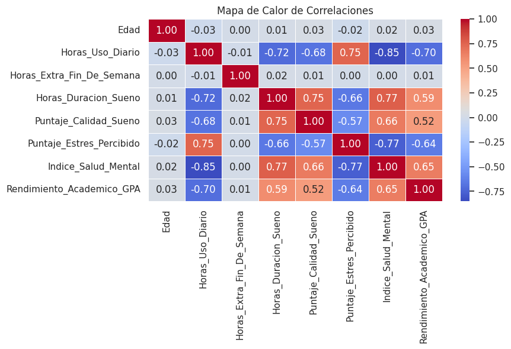
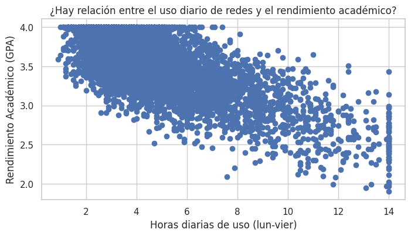
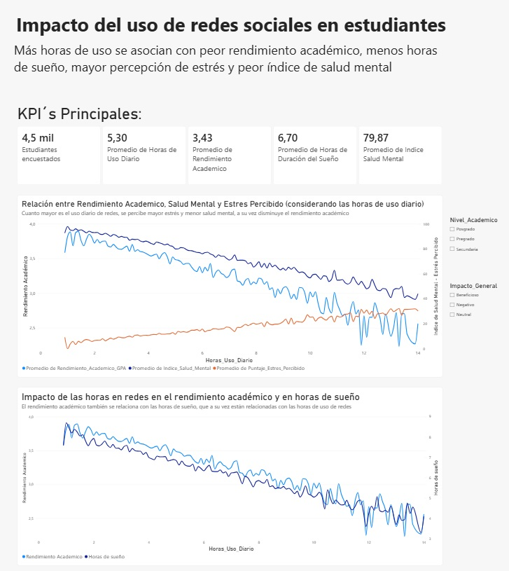

# 📱 Impacto del uso de redes sociales en estudiantes

Este proyecto analiza el impacto de la exposición a plataformas de *Social Media* en la vida de jóvenes estudiantes.
A partir de un dataset de **4.500 estudiantes** obtenido en Kaggle, se aplicaron técnicas de limpieza, análisis exploratorio y visualización en Python, y se elaboró un dashboard en Power BI.

**Hallazgo principal:** más horas de uso diario de redes sociales se asocian con peor rendimiento académico, menos horas de sueño, mayor estrés percibido y peor índice de salud mental.

---

## 🎯 Objetivo del proyecto

Analizar cómo se relacionan las horas de uso de redes sociales con factores clave de la calidad de vida de un estudiante:

- Horas de sueño y calidad autopercibida del sueño.
- Frecuencia de comparación social.
- Nivel de estrés percibido.
- Índice de salud mental.
- Rendimiento académico (promedio de calificaciones, GPA).
- Impacto general percibido.

---

## 🗂️ Dataset utilizado

- **Fuente:** Kaggle.com (*Social Media Impact on Life*).
- **Formato:** CSV.
- **Registros:** 4.500 estudiantes.
- **Variables:** 16 columnas, entre ellas edad, género, nivel académico, plataforma principal, horas de uso diario, horas de sueño, calidad del sueño, uso nocturno, frecuencia de comparación social, estrés percibido, índice de salud mental, rendimiento académico (GPA) e impacto general.

### Limpieza y transformaciones

- Traducción al castellano de los nombres de columnas y de los valores categóricos (género, nivel académico, uso nocturno, comparación social e impacto general).
- Detección de valores nulos en dos columnas: rendimiento académico (85 nulos) y estrés percibido (46 nulos). Al ser cantidades mínimas sobre el total, se reemplazaron por el promedio de cada variable.
- Exportación del dataset limpio en `utf-8-sig` para que Power BI y Excel lean correctamente las tildes.

---

## 🛠️ Herramientas utilizadas

- **Python** (pandas, matplotlib, seaborn)
- **Google Colab**
- **Power BI**
- **GitHub**

---

## 📊 Resultados principales

### KPIs generales

| Indicador | Valor |
|---|---|
| Estudiantes encuestados | 4.500 |
| Promedio de horas de uso diario | 5,30 h |
| Promedio de rendimiento académico (GPA) | 3,43 |
| Promedio de horas de sueño | 6,70 h |
| Promedio del índice de salud mental | 79,87 |

### Hallazgos

- **Salud mental:** es la variable más afectada. La correlación entre horas de uso diario e índice de salud mental es de **-0,85**: a más horas en redes, peor salud mental.
- **Estrés:** el estrés percibido aumenta a medida que crecen las horas de uso (correlación de **+0,75**).
- **Sueño:** más horas de uso se asocian con menos horas de sueño (**-0,72**) y peor calidad del sueño (**-0,68**).
- **Rendimiento académico:** el GPA cae a medida que aumenta el uso diario (**-0,70**), pasando de valores cercanos a 4 con poco uso a alrededor de 2,5 con 12 a 14 horas diarias.
- **Sueño y rendimiento van de la mano:** en el dashboard, las curvas de horas de sueño y rendimiento académico descienden casi en paralelo, lo que sugiere que el sueño podría ser una vía por la cual el uso de redes afecta al rendimiento.
- **Género:** no se observan diferencias significativas en las horas de uso diario según el género.
- **Nivel académico:** la relación positiva entre salud mental y rendimiento se mantiene en los tres niveles, aunque la muestra está desbalanceada (Pregrado 2.777, Secundaria 1.477, Posgrado 246).

> ⚠️ Las correlaciones muestran asociación, no causalidad.

### Visualizaciones destacadas





---

## 📈 Dashboard

El tablero de Power BI resume los KPIs principales y muestra cómo evolucionan el rendimiento académico, la salud mental, el estrés y las horas de sueño según las horas de uso diario. Incluye filtros por **nivel académico** e **impacto general**.



📁 Archivo: [`dashboard/Impacto_de_social_media.pbix`](dashboard/Impacto_de_social_media.pbix)

---

## 📁 Estructura del proyecto

```
impacto-redes-sociales-estudiantes/
├── data/
│   ├── Social_media_impact_on_life.csv       → dataset original (Kaggle)
│   └── Social_media_impact_on_life_es.csv    → dataset limpio y traducido
├── notebooks/
│   └── Trabajo_Social_Media_Final.ipynb      → análisis en Python
├── figs/                                     → gráficos exportados
├── dashboard/
│   ├── Impacto_de_social_media.pbix          → tablero Power BI
│   └── Tablero.jpg                           → captura del tablero
└── README.md
```

---

## ▶️ Cómo reproducir el análisis

1. Abrir `notebooks/Trabajo_Social_Media_Final.ipynb` en Google Colab.
2. Subir `data/Social_media_impact_on_life.csv` al entorno de Colab.
3. Ejecutar todas las celdas. Al final se genera el dataset limpio en castellano.
4. Para ver el tablero, abrir `dashboard/Impacto_de_social_media.pbix` con Power BI Desktop.

---

## 👤 Licencia y autoría

© 2026 – Proyecto académico realizado por **Santiago Tusman**
📧 tusmansantiago@gmail.com

Licencia: [Creative Commons Attribution 4.0](https://creativecommons.org/licenses/by/4.0/)
